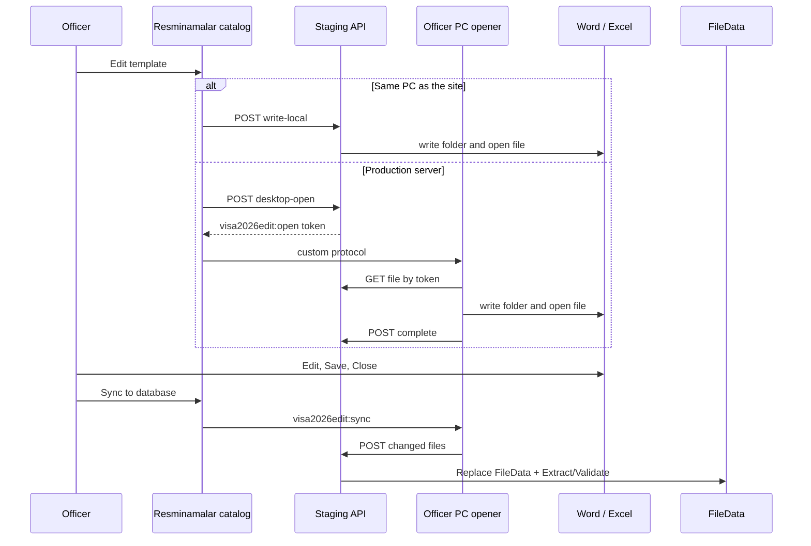
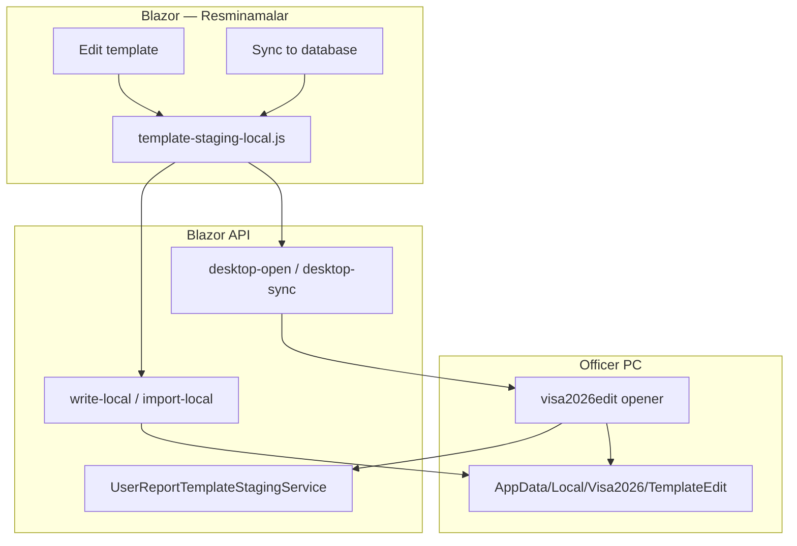

# Template staging edit — local sandbox (Resminamalar)

> **Status:** Implemented — officers edit Word/Excel templates from the Resminamalar catalog. The file lands in `%LOCALAPPDATA%\Visa2026\TemplateEdit` on the PC where **Edit template** was clicked. SMB/UNC share mode has been removed.  
> **Related:** [`APPLICATION_REPORT_PACKAGE.md`](APPLICATION_REPORT_PACKAGE.md), [`.cursor/skills/visa2026-resminamalar/SKILL.md`](../.cursor/skills/visa2026-resminamalar/SKILL.md).

Officers edit **user report templates** (`.docx` / `.xlsx`) from **Resminamalar** without opening User Report Template DetailView or manually downloading and re-uploading files. The template is written on the **officer PC**, opened in desktop Word/Excel, then synced back to the database. Saving in Word does not update the database. **Sync** on the Word or Excel Home tab publishes the open template. That button is installed once for Word and Excel, so it is there for templates already on the PC and for templates added later. The catalog **Sync to database** button does the same publish.

Production runs on another server, so that server cannot create the officer’s folder. Each officer PC installs a small opener once. A local development site (browser and process on the same PC) writes the folder itself.

---

## Officer workflow

| Step | Action | System |
|------|--------|--------|
| 1 | **Once per PC:** **Install on this PC** in the catalog | Downloads one zip. Unzip it and run `Install.cmd`. That installs Office trust, the opener, and Home → Sync. |
| 2 | **Edit template** on a catalog row | File is written to `%LOCALAPPDATA%\Visa2026\TemplateEdit` on this PC and opened in Word or Excel |
| 3 | Edit, **Save**, **Close** in Word/Excel | File stays on this PC. The row shows **In folder** |
| 4 | **Sync** on the Word or Excel **Home** tab, or **Sync to database** in the catalog | The Home button is installed once and shows for every template, including ones added later. It publishes the open file, including the profile copy Preview uses |
| 5 | **Refresh** (optional) | Reload catalog readiness only — does **not** import |



---

## Prerequisites

| Requirement | Notes |
|-------------|--------|
| **HTTPS** (production) | Officers open the site with `https://`. The opener accepts `https://` and `http://localhost` / `http://127.0.0.1` only. |
| **Windows officer PC** | Word and Excel desktop. The opener is PowerShell 5.1. |
| **One-time opener** | Required when the site is not running on the officer’s own PC. Installed by `Set-Visa2026TemplateEditOfficeTrust.ps1`. |
| **Permissions** | `UserReportTemplateEditAccess.CanEditTemplates()` (same gate as template DetailView maintenance). |

---

## Configuration

### `TemplateEditStaging` (appsettings)

```json
{
  "TemplateEditStaging": {
    "Enabled": true,
    "LocalFolderSubfolderName": "Visa2026\\TemplateEdit",
    "FileNamePattern": "{safeName}{extension}",
    "AutoExtractValidateOnImport": true,
    "MaxFileSizeBytes": 52428800
  }
}
```

| Setting | Purpose |
|---------|---------|
| `Enabled` | Master switch; when false, Edit template / Sync are hidden |
| `LocalFolderSubfolderName` | Relative path under `%LOCALAPPDATA%` (default `Visa2026\TemplateEdit`) |
| `FileNamePattern` | Tokens: `{templateId}`, `{safeName}`, `{extension}` |
| `AutoExtractValidateOnImport` | Run Extract + Validate after successful import when hash changed |
| `MaxFileSizeBytes` | Upload size limit (default 50 MB) |

### Development (`appsettings.Development.json`)

- `TemplateEditStaging:Enabled: true`
- F5 on `https://localhost:5001` or `http://localhost:5001` (localhost is a secure context)

### Production (IIS slot env)

In `C:\visa2026\env\prod.env` (see `scripts/windows-iis/env/prod.env.example`):

```env
TEMPLATE_EDIT_STAGING_ENABLED=true
HTTPS_ENABLED=true
HTTPS_PORT=443
```

Then deploy and run `Enable-Visa2026IisHttps.ps1` for the slot. `Configure-Visa2026Production.ps1` writes `TemplateEditStaging` into `appsettings.Production.json`.

---

## Officer PC setup (one-time, production)

The production server cannot write `%LOCALAPPDATA%` on the officer PC. In Resminamalar, click **Install on this PC**. That downloads `Visa2026-TemplateEdit-Setup.zip` for the site the officer is using. Unzip it and run `Install.cmd` once. That creates `%LOCALAPPDATA%\Visa2026\TemplateEdit` for temporary template files, and installs the Office trust script, the Word/Excel Sync add-in, and the opener. No Visual Studio is required on the officer PC. Close Word and Excel, then click **Edit template**.

The same scripts can still be run from the repo on an admin workstation:

**Production** (officers open `https://10.100.128.25`):

```powershell
.\scripts\windows-iis\Set-Visa2026TemplateEditOfficeTrust.ps1 -ServerHost 10.100.128.25
```

**Local dev** (`localhost:5001`), only if Word shows a Restricted Sites warning:

```powershell
.\scripts\windows-iis\Set-Visa2026TemplateEditOfficeTrust.ps1 -IncludeLocalhost
```

On a development PC where the browser and the site are the same machine, **Edit template** creates the folder without the protocol. Close Word and the browser, hard-refresh, then click **Edit template** again. Fallback: open the file from `%LOCALAPPDATA%\Visa2026\TemplateEdit` or use **Copy path**.

---

## Architecture



Same-machine development uses `write-local` and `import-local`. Production uses `desktop-open` and `desktop-sync`. The opener is authorized by a 3-minute in-memory token, not by the officer’s browser cookie.

### Key files

| Area | Files |
|------|--------|
| **Module** | `UserReportTemplateStagingService`, `TemplateEditStagingOptions`, `UserReportTemplateStagingPathHelper`, `UserReportTemplateStagingMeta` |
| **Blazor** | `ApplicationReportPackageComponent.razor`, `TemplateEditDesktopBroker`, `UserReportTemplateStagingController` |
| **JS** | `wwwroot/js/template-staging-local.js` |
| **Officer PC** | `scripts/windows-iis/template-edit-setup/` (`Install.cmd`), `Invoke-Visa2026TemplateEdit.ps1`, `Set-Visa2026TemplateEditOfficeTrust.ps1`, `Install-Visa2026OfficeSyncAddin.ps1` |

### API endpoints

| Method | Path | Purpose |
|--------|------|---------|
| `POST` | `/api/user-report-templates/{id}/staging/write-local` | Development: write the file on this PC and return the path |
| `POST` | `/api/user-report-templates/staging/import-local` | Development: import changed files from this PC |
| `POST` | `/api/user-report-templates/{id}/staging/desktop-open` | Production: issue `visa2026edit:open` |
| `POST` | `/api/user-report-templates/staging/desktop-sync` | Production: issue `visa2026edit:sync` |
| `GET` | `/api/user-report-templates/staging/desktop/{token}` | Opener downloads the template (token only) |
| `POST` | `/api/user-report-templates/staging/desktop/{token}/upload` | Opener uploads one changed file |
| `POST` | `/api/user-report-templates/staging/ribbon-sync` | Word/Excel Home **Sync** publishes the open template |
| `GET` | `/api/user-report-templates/staging/pc-setup` | Download `Visa2026-TemplateEdit-Setup.zip` for this PC |
| `POST` | `/api/user-report-templates/staging/desktop/{token}/complete` | Opener reports the result |
| `GET` | `/api/user-report-templates/staging/desktop/{token}/result` | Page polls until the opener finishes |

---

## Rollout checklist (production)

1. Set slot env: `TEMPLATE_EDIT_STAGING_ENABLED=true`, `HTTPS_ENABLED=true`, `HTTPS_PORT=443`
2. Deploy publish output to IIS slot
3. Run `Enable-Visa2026IisHttps.ps1 -Profile Production -RedirectHttpToHttps`
4. Run `Configure-Visa2026Production.ps1 -Profile Production`
5. Officers use **`https://`** URL (not `http://`)
6. On each officer PC: **Install on this PC**, unzip, run `Install.cmd` once
7. Officer onboarding: Edit template → save in Word or Excel → Sync to database

---

## Non-goals

- SMB/UNC network shares for template staging (removed)
- In-browser Spreadsheet / Rich Edit on DetailView
- Editing ministry seed files in git (`Resources/Templates/`)
- Version history or check-out UI (v1: last sync wins)
- Auto-sync without officer clicking **Sync to database**

---

## Troubleshooting

| Symptom | Check |
|---------|--------|
| Word or Excel did not open | On that PC, click **Install on this PC**, run `Install.cmd` once, then click **Edit template** again. Log: `%LOCALAPPDATA%\Visa2026\TemplateEdit\edit-host.log` |
| Export failed / staging disabled | `TemplateEditStaging:Enabled`, user has edit permission |
| Sync finds nothing | File saved in Word? `%LOCALAPPDATA%\Visa2026\TemplateEdit`? `.meta.json` next to the file? |
| Word "Restricted Sites" | Run the Office trust script; use HTTPS; or open the file from Explorer |
| HTTPS required | Production must use HTTPS; run `Enable-Visa2026IisHttps.ps1` |

---

## Removed (SMB share mode)

The following were removed when switching to local sandbox only:

- `TemplateEditStaging:StagingRootUnc`, `StagingLocalPath`, `Mode` enum
- `Ensure-Visa2026TemplateEditShare.ps1`, `Ensure-TemplateEditDevShare.ps1`
- `template-staging-edit.js`, server-side share scan (`ImportAllChangedAsync`)
- Port 445 / SMB ACL / `TEMPLATE_EDIT_UNC_HOST` / `TEMPLATE_EDIT_OFFICERS_PRINCIPAL`
