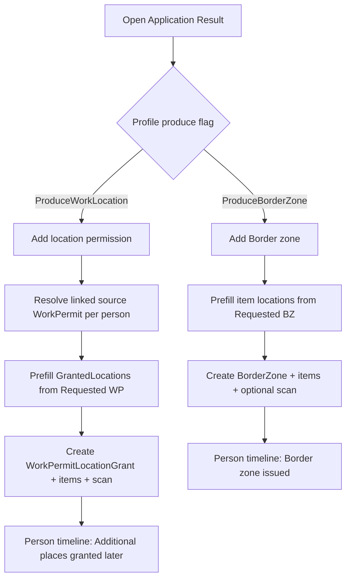

# Work permit location grant + requested locations

**Status:** Prototypes + domain plan locked (2026-11-05).  
**Profiles:** Serhet Ýaka Üçin Rugsatnama Almak · Iş Rugsatnama goşmaça barjak ýeri  
**Skill:** `.cursor/skills/visa2026-application-profile/`

## Locked shape

| Profile | Linked data | Issued result |
|---------|-------------|---------------|
| Serhet Ýaka (`get_border_zone`) | Requested border zone location (person BO) | Existing `BorderZone` + `BorderZoneItem` |
| Goşmaça barjak ýeri (`change_workpermit`) | Requested work permit location (person BO) | New `WorkPermitLocationGrant` + items (**never** mutates `WorkPermitItem.WorkPermittedLocations`) |

Original WP / visa issue locations stay on those issued documents. Later grants / BZ permits are separate documents.

## Prototypes

| File | Story |
|------|--------|
| [`prototypes/gosmaca-barjak-yeri-01-linked-requested-wp.jpg`](prototypes/gosmaca-barjak-yeri-01-linked-requested-wp.jpg) | People & links: source WP + Requested WP location chips |
| [`prototypes/gosmaca-barjak-yeri-02-result-grant-compose.jpg`](prototypes/gosmaca-barjak-yeri-02-result-grant-compose.jpg) | Application Result: New location permission drawer |
| [`prototypes/serhet-yaka-01-linked-requested-bz.jpg`](prototypes/serhet-yaka-01-linked-requested-bz.jpg) | Requested BZ location + Add Border zone |
| [`prototypes/location-permissions-timeline-01.jpg`](prototypes/location-permissions-timeline-01.jpg) | Person timeline: original vs later grants |

## Officer algorithm

### Goşmaça barjak ýeri steps

1. Case summary / chips collect **requested** places → `ApplicationProfileInstancePersonRequestedLocation` (Kind WorkPermit).
2. Officer links each person’s **existing** WorkPermit item (source permission).
3. After ministry approval → Result → **WorkPermitLocationGrant**; lines default from requested BO; attach letter scan.
4. Persist grant only. Source `WorkPermitItem.WorkPermittedLocations` unchanged.
5. Maglumat-3 / dossier list grants by source permit + grant date (legacy fallback: case `MovementPermitLocation` on issued `change_workpermit` apps).

## Seed flags

- `change_workpermit`: `ProduceWorkLocation=true`, **`ProduceWorkPermit=false`**, `RequireWorkPermitLocation=true`, `RequirePersonWorkPermitItem=true`.
- `get_border_zone`: unchanged produce Border zone; linked BZ location via requested BO.