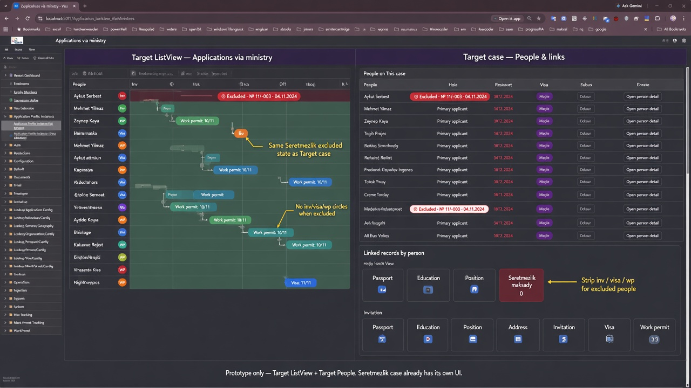

# Seretmezlik state + hide issuance circles

Implemented (slice **15g**, 2026-11-04).

## Locked decisions

1. **Where:** Target case People already shows Excluded. Reuse that **exact** badge on the **Target** Application Profile Instance **ListView** (People column).
2. **Hide circles:** On Target, when a person is excluded, **strip Inv / Visa / WP / Border zone / Rejection** — ListView People marks and case **People & links** tiles. Keep master-data tiles (Passport, Education, WorkDuty, …).

## Prototype

