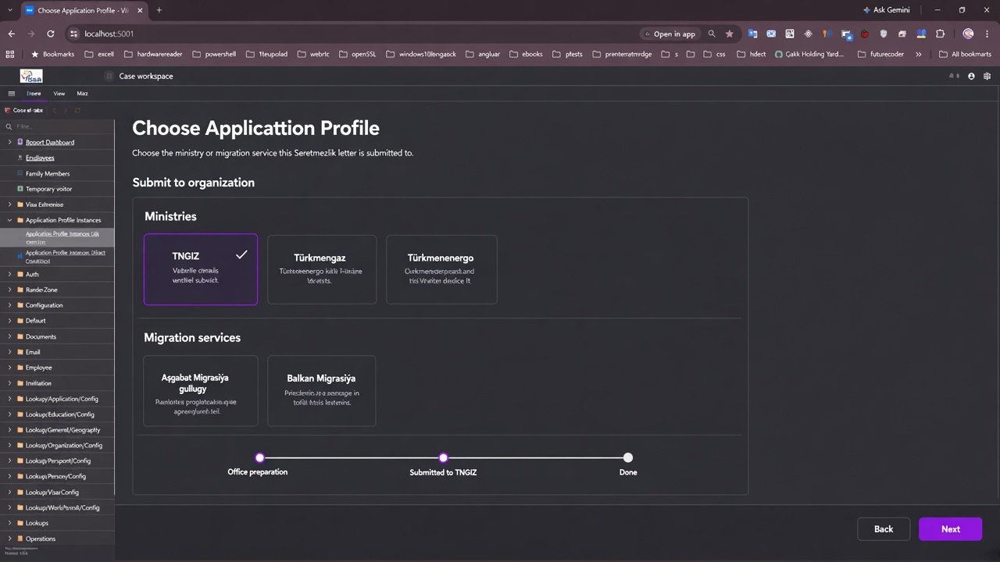

# Seretmezlik — Submit to organization (create wizard)

## Locked decisions (2026-11-03 / refined 2026-11-04)

1. **Progress depth** — After **Submitted to {org}**, that is the last operational step (then close). No AS number / further migration node.
2. **Create lists** — Seretmezlik on **both** Via and Direct New lists.
3. **Via create** — Show **Submit to organization** with **Ministries only** (hide Migration services). Case summary destination = ministries only; editable after create.
4. **Direct create** — **Skip** Submit to organization. Leave destination empty; progress uses generic **Submitted to migration service** (same as invitation change). Hide destination field on Case summary.
5. **Catalogs** — Via uses `ApprovingMinistry` only.
6. **Existing Via Seretmezlik with Approval legs** — Leave as-is (local dev).

## Prototype

## Implementation notes

- Profile flag `RequireSubmitToOrganization`.
- Instance FKs `SubmitToApprovingMinistry` / `SubmitToMigrationService` (Via sets ministry).
- Wizard org step only when create-list route is Via.
- `ShowSubmitToOrganization` requires Via `CreationProgressRoute`.