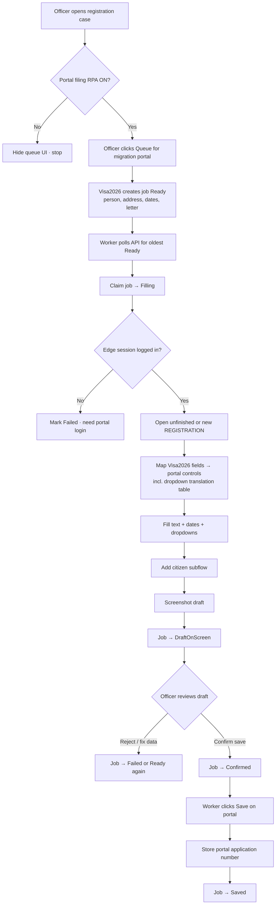

# Playwright RPA as a Visa2026 feature (prototype)

Conceptual prototype — worker **scaffold** lives in [Visa2026.PortalFiling.Worker](../../Visa2026.PortalFiling.Worker/README.md) (no form fill yet). Explores turning portal filing on/off inside Visa2026 while Playwright runs as a separate Windows worker.

## Locked product ideas (for discussion)

| Topic | Decision sketch |
|-------|-----------------|
| Feature toggle | **Portal filing (RPA)** in settings (or role permission). OFF hides queue UI. |
| Where Playwright runs | Separate Windows worker + Edge profile — **not** inside Blazor/IIS. |
| Visa2026 role | Queue job from case, show status, officer **Confirm save**. |
| Worker role | Poll Ready jobs, fill `rgstr.migration.gov.tm`, screenshot, wait. |
| Secrets | Migration portal login stays in Edge profile; Visa2026 uses JWT/OData only. |
| Mode | Attended first (officer watches / confirms). Unattended later if licensed/ops allow. |

## Screens

| File | State |
|------|--------|
| [playwright-rpa-visa2026-integration-01-overview.jpg](./playwright-rpa-visa2026-integration-01-overview.jpg) | Split: Visa2026 case + toggle/queue/status ↔ Playwright worker filling portal. |
| [playwright-rpa-visa2026-integration-02-steps.jpg](./playwright-rpa-visa2026-integration-02-steps.jpg) | Six-step storyboard: Feature ON → Queue → Claim → Fill → Review → Save. |

## Process algorithm

Actors: **Officer** (Visa2026 UI), **Visa2026** (API + job store), **Playwright worker** (Windows + Edge), **Migration portal** (government site).

Job statuses: `Ready` → `Filling` → `DraftOnScreen` → `Confirmed` → `Saved` (or `Failed` from any step after `Ready`).

### Flowchart



### Pseudocode

```text
FEATURE PortalFilingRpa = SystemSettings.Enabled AND user.HasPermission

ON Officer.Queue(caseId):
  IF NOT FEATURE: refuse
  payload = LoadPersonAddressDatesLetter(caseId)
  IF payload incomplete: refuse with gaps
  job = CreateJob(caseId, payload, status=Ready)
  RETURN job.Id

LOOP Worker every N seconds:
  IF NOT FEATURE: sleep; continue
  job = ClaimOldest(status=Ready) → status=Filling
  IF job is null: continue

  TRY
    browser = AttachEdge(profile=MigrationPortal)
    IF browser shows login page:
      Fail(job, "Portal session expired")
      CONTINUE

    page = OpenApplication(job)   // new or existing unfinished URL
    values = Map(job.payload, DropdownTranslationTable)
    FillMainForm(page, values)
    AddCitizen(page, values.person, values.passport)
    shot = Screenshot(page)
    AttachScreenshot(job, shot)
    job.status = DraftOnScreen
    Persist(job)
    // stop — do not save on portal yet

  CATCH uiOrNetworkError:
    Fail(job, error)
    CONTINUE

ON Officer.ConfirmSave(jobId):
  job = Get(jobId)
  REQUIRE job.status == DraftOnScreen
  job.status = Confirmed
  Persist(job)

LOOP Worker also handles Confirmed:
  job = ClaimOldest(status=Confirmed) → status=Saving
  TRY
    ClickSave(portal)
    job.PortalApplicationNumber = ReadNumber(portal)
    job.status = Saved
  CATCH:
    Fail(job, error)
```

### Field mapping (main form)

| Portal control | Source |
|----------------|--------|
| Application type | Fixed `REGISTRATION` (or mapped from case type) |
| Type of location / Place of stay / Address district | Translation table (Visa2026 label → portal label) |
| Registration date from–to | Job / stay dates |
| Address street, building, block, apartment | `AddressOfResidence` |
| Workplace | Person workplace text |
| Letter number / Letter date | Letter chosen on queue |
| Note | Optional officer note on job |
| Add citizen | `Person` + current `Passport` |

### Failure rules

1. Feature off → no new jobs; worker idle.
2. Missing required Visa2026 data → cannot queue.
3. Portal login page → `Failed` (officer signs in on that PC).
4. Dropdown label not in translation table → `Failed` (do not guess).
5. UI selector miss / page change → `Failed`, leave form unsaved.
6. Save on portal only after officer `ConfirmSave`.

## Out of scope for this prototype

- Power Automate Desktop path (alternative robot; same Visa2026 job model).
- Exact portal **Add citizen** field map.
- Production SLA / legal approval to automate the government site.